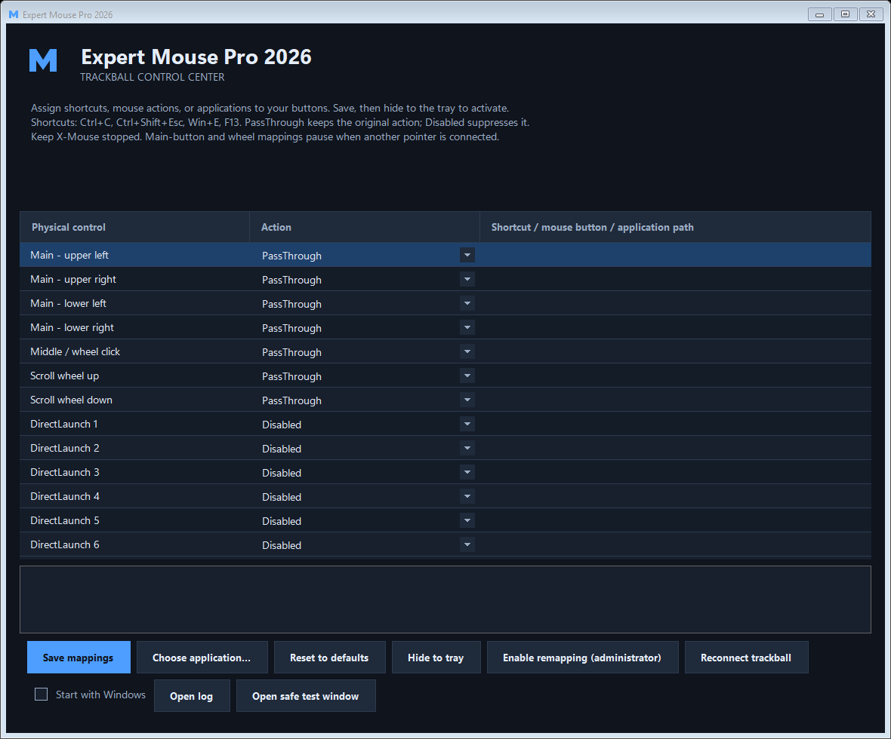
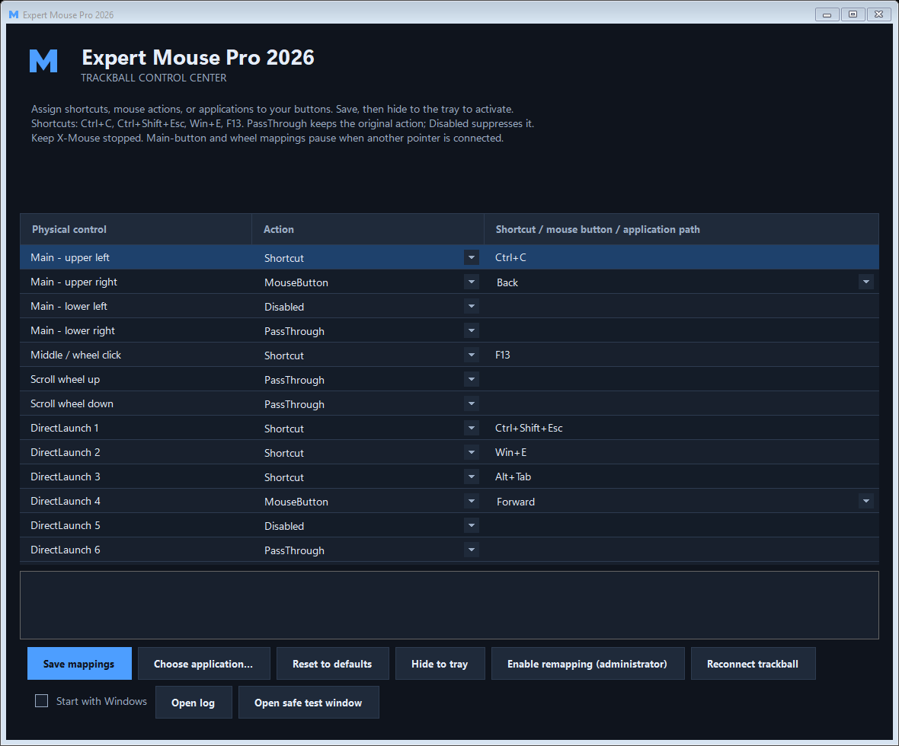

# Expert Mouse Pro 2026

[Download the latest Windows installer](https://github.com/asw2012/-expert-mouse-pro-2026/releases/latest)

A community Windows 11 tray remapper for the **Kensington Expert Mouse Pro**
with four main buttons, a wheel click, and six DirectLaunch buttons.

**Experimental release.** Tested with a USB `047D:1002` trackball on one
Windows 11 PC. Other Kensington models, wireless variants, and every Windows
security configuration are not verified. This is not official Kensington
software and is not affiliated with or endorsed by Kensington.

## Download and install

Download **`ExpertMousePro2026-Setup-<version>-win-x64.exe`** from this
repository's **Releases** page. Use the Setup EXE, not GitHub's source-code ZIP,
if you only want to install and use the app.

1. Double-click Setup and approve Windows' administrator prompt.
2. Review the installation information and choose an installation folder.
3. If USBPcap is missing, setup offers to download its official installer.
   **No driver download or installation happens without consent.** The verified
   official installer then opens visibly so you can review and separately
   accept its driver and USBPcapCMD license screens. Declining or canceling it
   stops setup.
4. Finish setup. If a driver was installed, restart Windows before using
   remapping.
5. Open **Expert Mouse Pro 2026** from the Start menu.
6. Exit X-Mouse Button Control while this app is running. You can keep X-Mouse
   installed as a fallback.
7. Assign actions, click **Save mappings**, then **Hide to tray**.

The app's .NET Desktop runtime is included in the installer. End users do not
need a .NET SDK or a separate .NET runtime installation.

### Requirements and driver compatibility

- Windows 11 **x64**, not ARM64 or 32-bit Windows.
- An administrator account; USBPcap access requires elevation.
- Kensington Expert Mouse Pro USB hardware ID **VID_047D / PID_1002**.
- Internet access during setup only if the USBPcap driver is missing.

The app uses the independent **USBPcap 1.5.4.0** driver to read reports before
Windows drops the extra button states. The original Kensington drivers are
not installed or distributed.

USBPcap's official compatibility list names Windows 7/8/10, not Windows 11.
It works on the development PC, but a fresh Windows 11 installation may reject
the driver under its signing or Memory Integrity requirements. This project
does **not** disable Secure Boot, Memory Integrity, or signature enforcement.
If Windows rejects the driver, stop rather than weakening those protections.

Setup verifies the USBPcap download against a pinned SHA-256 digest of the
official, Authenticode-verified release, then launches the original installer
interactively; its license acceptance is not skipped or automated. The driver
keeps its own licenses. USBPcap binaries are not embedded in this project's
installer or source tree.

Until the app/installer is signed with a trusted code-signing certificate,
Windows may show an unknown-publisher or SmartScreen warning. GitHub hosting
does not remove those warnings. Release assets include `SHA256SUMS.txt`.

## Features

- Blue **M** tray, window, and executable icons.
- Dark theme with Segoe UI Variable fonts (standard Segoe UI fallback on
  systems without the variable fonts).
- Assignments for all **13 controls**: four main buttons, wheel click, two
  wheel directions, and six DirectLaunch buttons.
- Pass-through, disable, mouse button, keyboard shortcut, or application launch.
- Saved mappings, Pause, Reconnect, and optional Start with Windows.
- A focused input-test window to verify shortcuts, clicks, drags, and releases.
- Read-only Raw Input and USB capture diagnostics.

## Screenshots

The settings window shows all 13 assignable controls. The default setup
preserves the four main buttons and wheel while leaving DirectLaunch buttons
disabled:



Example assignments show shortcuts and mouse-button actions:



These screenshots were rendered with example settings; they do not show
anyone's saved settings.

Mapped mouse actions stay held until release, supporting dragging. Shortcuts
run once on press, for example `Ctrl+C`, `Ctrl+Shift+Esc`, `Win+E`, or `F13`.
Wheel assignments perform a tap per scroll step. Application assignments must
point to an existing `.exe`.

The remapper runs elevated. Applications it launches can inherit that
elevation; only assign trusted executables.

Per-application profiles, arbitrary scripts, and macro sequences are not
implemented.

## Tray, settings, and startup

Double-click the blue **M** tray icon to edit assignments. Windows may put it
in the tray overflow under the up-arrow.

**Mapping pauses while the settings window is visible.** Save your changes,
then hide the window to the tray to activate them. X/Close and Minimize hide
the settings window; use the tray menu's **Exit** to stop the app.

Defaults leave ordinary mouse/wheel behavior unchanged and DirectLaunch
buttons unassigned.

To start automatically, check **Start with Windows**, click **Save mappings**,
and approve its confirmation. This creates a highest-available, interactive
logon task for your account. It is not a SYSTEM service. Uncheck and save to
remove the task. Setup preserves an existing enabled startup choice when
moving the app to its installed location; it does not opt new users in.

The executable remains `ExpertMouse.exe`, even though the display name is
Expert Mouse Pro 2026. Existing settings and startup identities are retained.

Settings and bounded logs are in `%LOCALAPPDATA%\ExpertMousePro`. Invalid
settings show an error and leave remapping off; they are not silently reset.
Use Reset to defaults and Save if you need to repair them.

Uninstall removes the application and startup tasks pointing to that
installation. It leaves personal settings and the shared USBPcap driver
untouched. Other applications, such as Wireshark, may depend on USBPcap.

## Safety limits

- X-Mouse being detected pauses all assignments to avoid competing remappers.
  This app does not kill it or change its configuration.
- Main-button/wheel suppression is only active when the trackball is the sole
  mouse reported by Raw Input. Connecting another mouse/touchpad, or using
  Remote Desktop, makes those controls pass through. DirectLaunch assignments
  can still work.
- Windows can also list unnamed virtual pointers. These no longer trigger
  repeated "Read device name" errors, but still count as additional pointers
  for safety. The status identifies this condition; DirectLaunch assignments
  remain available while main buttons/wheel pass through.
- Main-button actions pass through over the taskbar/tray and this app's own
  interface, keeping settings accessible.
- Release all controls and move the ball once if synchronization is pending.
- Capture failures release mapped outputs, restore ordinary mouse actions,
  notify the user, and retry connection.
- Applications using their own Raw Input can still see original main-button
  events. Secure-desktop and anti-cheat compatibility are not promised.
- `Ctrl+Alt+Delete` cannot be synthesized. Use `Ctrl+Shift+Esc` for Task Manager.
- Do not run another USBPcap capture on the same root hub at the same time.

The remapper does not continuously save USB traces or record keyboard input.
The optional test window records only its own focused input events.

## Verify an assignment

Assign a harmless shortcut such as `F13` to a DirectLaunch button and a mouse
action to one upper main button. Save, then use **Open safe test window**.
Settings hide so mapping can operate in the separate test window.

Check for one press/release, no original button event, and a correct release
after a held drag. **Save test events and close** saves that test's events
under `%LOCALAPPDATA%\ExpertMousePro\input-test-events.json`.

## Build from source

Build tools: Windows x64, .NET 10 SDK, and PowerShell 7.

```powershell
dotnet build .\ExpertMouse\ExpertMouse.csproj -c Release
& .\ExpertMouse\bin\Release\net10.0-windows\ExpertMouse.exe --self-test
& .\ExpertMouse\bin\Release\net10.0-windows\ExpertMouse.exe --app
```

### Build the installer

Inno Setup 6.7.3 or newer is required. The optional bootstrap script installs
the verified compiler **for the current user** in an ignored build-tools
cache. It does not install USBPcap.

```powershell
.\installer\install-build-tools.ps1
.\installer\build.ps1
```

The build restores a pinned, serviced .NET runtime, publishes a self-contained
Windows x64 app, runs executable checks, compiles Setup, exports original
source, validates the assets, and writes SHA-256 hashes.

Outputs in `dist`:

- `ExpertMousePro2026-Setup-<version>-win-x64.exe`
- `ExpertMousePro2026-Source-<version>.zip`
- `SHA256SUMS.txt`

Build versions and verified dependency URLs/hashes are in
`installer\dependencies.json`. Update them intentionally when servicing a
release. Do not commit caches, published runtime files, captures, signing
keys, or the original Kensington packages.

The included GitHub Actions build workflow produces tested installation
assets. After publishing the source in the intended account/repository,
pushing a version tag such as `v0.1.0` runs the release workflow and creates an
experimental GitHub Release with the Setup EXE, source archive, and checksums.
No workflow runs merely because these files exist locally.

## USB protocol and reconstruction

MouseWorks 5.61/6.22 installers were inspected to identify their filter roles
and supported hardware ID. Their x86 kernel binaries cannot be converted into
x64 drivers by editing an INF. No vendor driver implementation was copied
into this app.

The live device advertises button usages 1..11, but ordinary Windows
`RAWMOUSE` events omit the six DirectLaunch states. USB-level input contains
five bytes; the Windows HID API representation includes an extra report-ID
slot and is six bytes.

Verified stationary single-button USB masks (zero-based byte indexes):

| Control | Byte | Press mask / delta |
| --- | --- | --- |
| Main lower left | 0 | `0x01` |
| Main lower right | 0 | `0x02` |
| Middle / wheel click | 0 | `0x04` |
| Main upper left | 0 | `0x08` |
| Main upper right | 0 | `0x10` |
| Scroll up / down | 3 | signed `+1` / `-1` |
| DirectLaunch 1..6 | 4 | `0x01`, `0x02`, `0x04`, `0x08`, `0x10`, `0x20` |

Button releases in those tests were `0000000000`. The app ignores the motion
bytes for remapping. Simultaneous physical combinations and compatibility
with every target application have not been validated.

Executable checks cover capture framing/filtering, mapping ownership,
suppression pairs, deferred injection, failure cleanup, settings persistence,
startup cleanup scope, branding, fonts, and readable contrast. A live test also
verified a single F13 press/release and a Right-button drag/release without the
original Back-button action.

Optional diagnostics:

```powershell
& .\ExpertMouse\bin\Release\net10.0-windows\ExpertMouse.exe --probe
& .\ExpertMouse\bin\Release\net10.0-windows\ExpertMouse.exe --usb-probe
$results = Join-Path $PWD 'ExpertMouse\captures\my-usb-test.json'
& .\ExpertMouse\bin\Release\net10.0-windows\ExpertMouse.exe --usb-capture $results
```

USB capture requires administrator access and records only the verified
trackball's bus/address. Captures can contain device identities and are
excluded from public source exports.

## License and attribution

The original app source and blue M artwork are **MIT-licensed**; see
[LICENSE](LICENSE). Separate runtime/driver/build-tool notices are in
[THIRD-PARTY-NOTICES.txt](THIRD-PARTY-NOTICES.txt).

Proprietary Kensington packages, personal captures, logs, settings, and
credentials are not part of the public source distribution.

References:

- [USBPcap project](https://desowin.org/usbpcap/)
- [USBPcap 1.5.4.0 release and source](https://github.com/desowin/usbpcap/releases/tag/1.5.4.0)
- [USBPcap capture format](https://desowin.org/usbpcap/captureformat.html)
- [Windows HID architecture](https://learn.microsoft.com/en-us/windows-hardware/drivers/hid/hid-architecture)
- [RAWMOUSE](https://learn.microsoft.com/en-us/windows/win32/api/winuser/ns-winuser-rawmouse)
- [Inno Setup](https://jrsoftware.org/isinfo.php)
